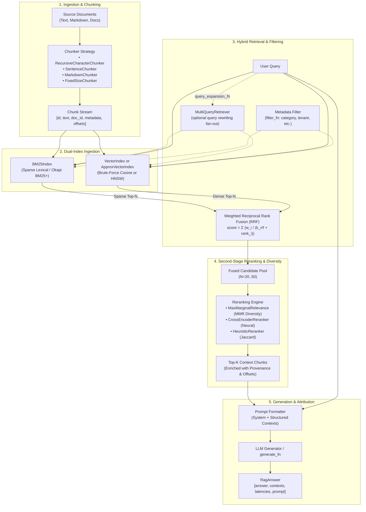
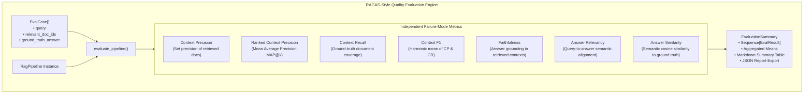

# Architecture & System Design

`ragforge` is designed around a modular, two-stage retrieve-and-rerank architecture with end-to-end evaluation and offline indexing capabilities.

---

## 1. End-to-End Pipeline Overview

---

## 2. Evaluation Flow (RAGAS-Style)

---

## 3. Key Architectural Decisions & Tradeoffs

### A. Reciprocal Rank Fusion (RRF) over Weighted Score Blending
- **The Problem:** BM25 produces unbounded positive scores ($0.0 \to \infty$) while cosine similarity bounded in $[-1.0, 1.0]$. Normalizing disparate score distributions via min-max scaling is brittle and sensitive to outlier chunks.
- **The Solution:** RRF operates purely on ordinal ranks:
  $$\text{RRF}(d) = \sum_{m \in \{\text{bm25}, \text{vector}\}} \frac{w_m}{k_{\text{rrf}} + \text{rank}_m(d)}$$
  This eliminates calibration drift and ensures neither signal dominates due to score magnitude.

### B. Maximal Marginal Relevance (MMR) for Context Window Optimization
- **The Problem:** Dense vector retrieval often returns top-5 chunks that are syntactic variations of the same paragraph, wasting precious LLM context tokens without introducing new information.
- **The Solution:** MMR dynamically balances relevance against intra-context redundancy:
  $$\text{MMR}(d_i) = \lambda \cdot \text{Sim}(d_i, q) - (1 - \lambda) \max_{d_j \in S} \text{Sim}(d_i, d_j)$$
  Setting $\lambda = 0.7$ provides optimal query relevance while ensuring diversity across retrieved chunks.

### C. Multi-Strategy Chunking Hierarchy
- `RecursiveCharacterChunker`: Standard recursive splitting respecting natural document hierarchy (paragraphs $\to$ sentences $\to$ words).
- `SentenceChunker`: Preserves complete semantic sentence boundaries for prose.
- `MarkdownChunker`: Extracts document section headers and attaches them to chunk metadata for structured citation.
- `FixedSizeChunker`: Fast word-count sliding window for homogeneous unstructured text.

### D. Zero-Downtime Index Persistence
Indices serialize cleanly to JSON:
- Offline batch indexing jobs build and save the index (`pipeline.save("index.json")`).
- Online serving instances load pre-built indices (`RagPipeline.load("index.json")`) without re-computing embeddings on startup.
- `ragforge serve` (built on stdlib `http.server`) loads a saved index and exposes it as a JSON API, without changing anything about how the index was built.

### E. HNSW as a Pluggable Backend, Not a Rewrite
- **The Problem:** `VectorIndex`'s brute-force cosine scan is exact but `O(n)` per query -- adequate for thousands of chunks, a bottleneck at millions.
- **The Solution:** `ApproxVectorIndex` implements the same public surface (`add`, `delete`, `search`, `to_dict`/`from_dict`) over a from-scratch HNSW graph (`src/ragforge/ann.py`), satisfying a shared `VectorSearchable` protocol so `HybridRetriever` and `RagPipeline` never branch on which backend is active. Selecting it is a single `use_ann=True` flag; persistence records which backend was used so `load()` reconstructs the same one.

### F. Multi-Query Retrieval Reuses RRF Instead of a New Fusion Strategy
- **The Problem:** Hybrid RRF fuses lexical and semantic signal for *one* phrasing of a query; a paraphrase sharing no vocabulary with the target chunk can still miss entirely.
- **The Solution:** `MultiQueryRetriever` fans a query out into rewritten variants (`QueryExpansionFn`) and retrieves each independently, then fuses all result lists -- original query included -- with the *same* weighted RRF formula used for BM25/vector fusion (see Decision A). One fusion primitive, reused at both the multi-signal and multi-phrasing level.

### G. Lazy-Import Adapters Instead of Optional Dependencies
- **The Problem:** Real embedding providers (OpenAI, Cohere, sentence-transformers) and observability backends (OpenTelemetry) are essential in production but would compromise the zero-required-dependency core if imported eagerly.
- **The Solution:** `src/ragforge/embeddings_providers.py` and `otel_exporter` in `src/ragforge/telemetry.py` import their client library *inside* the factory function, only when actually called, raising a clear `ImportError` with the exact `pip install` command otherwise. `import ragforge` never requires any of them.

---

### H. Guardrails Live in the Pipeline, Not in the Prompt

`RagPipeline(guardrails=...)` screens each retrieved context *after* reranking
and *before* the prompt is formatted, so every consumer -- `answer`,
`answer_stream`, the agent, the HTTP server and the MCP server -- inherits the
same policy. Findings travel with the chunk (`RetrievedChunk.guardrails`) and
as a `guardrails` tracer span, which keeps poisoning visible and auditable
rather than silently filtered.

### I. Verifiable Citations as Post-Processing

Attribution (`ragforge.citations.attribute`) is a pure function of
`(answer, contexts)`, not a generation mode. It therefore works for extractive
answers, any LLM, and answers that already contain `[1]` markers (which it
*verifies* rather than trusts).

### J. The Agent Is a Thin Loop over the Pipeline

`AgenticRag` adds no new retrieval machinery: it calls `pipeline.retrieve`,
so hybrid fusion, reranking, guardrails and tracing all apply unchanged. Its
decision points (decompose / grade / rewrite) are plain callables with
deterministic lexical defaults and `llm_*` factories, and every step is
recorded for inspection.

### K. MCP Is a Transport, Not a Feature

`ragforge.mcp_server.MCPServer` is a transport-agnostic JSON-RPC handler; the
stdio loop is ~15 lines. Tools are read-only unless the operator opts in to
ingestion, because anything an LLM can call, an attacker's prompt can call.

### L. The Web Playground Runs the Library, Not a Re-Implementation

`web/` is static HTML/ES modules plus a zip of `src/ragforge`, loaded into
Pyodide (CPython on WebAssembly) inside a Web Worker. `web/bridge.py` is the
only glue, exchanging JSON strings; `tests/test_web_bridge.py` exercises it in
CPython so the demo cannot drift from the library.

### M. Every Extra Ranker Is Just Another RRF Source

SPLADE, the entity graph and any custom index plug into `extra_indexes` and join the same weighted RRF as BM25 and
vectors (`FusionRetriever` when used standalone). Rank fusion needs no score calibration, so adding a ranker never
requires retuning the others. The query router only changes the *weights* per query.

### N. Quantize for Search, Rescore for Quality

Codes (int8, 1 bit) are only used to pick a candidate pool; the final ordering uses the full-precision vectors. This
is why int8 matches the float index in the [evaluation](evaluation.md) and binary loses little: the codes never decide
the final rank on their own.

### O. Filters Belong Inside the Graph Walk

Over-fetching and post-filtering silently returns short lists under selective filters. Evaluating the predicate during
the traversal, with an exact-scan fallback, turns "wrong" into "slower" (see the [blog post](blog/hnsw-recall-bug.md)).

### P. On-Disk Indexes Are a Directory, Not a Bigger JSON

`DiskIndex` memory-maps vectors, stores the graph in CSR form, appends chunks to a log and switches versions with an
atomic manifest rename under a single-writer lock. Opening is O(1) in corpus size and a crash leaves the previous
version readable.

### Q. Serving and Tenancy Stay Thin

The ASGI app is ~one file of pure ASGI (no framework); `MultiTenantRag` gives each tenant an isolated pipeline, so
isolation is by construction rather than by a `tenant_id` filter that someone can forget.

## 4. Further Reading

See [`docs/math.md`](math.md) for full derivations behind every scoring
function referenced above: the probabilistic origin of BM25, why RRF fuses
ranks instead of scores, the submodularity argument behind MMR's
approximation guarantee, and the complexity analysis of the HNSW
approximate nearest-neighbor index (`src/ragforge/ann.py`).
