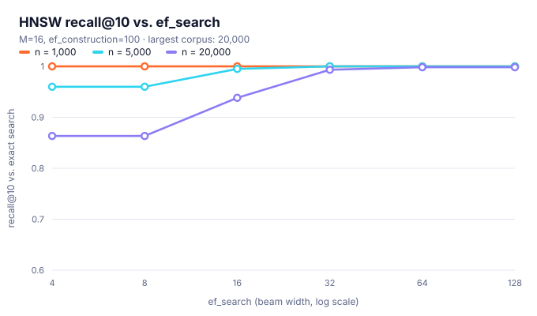
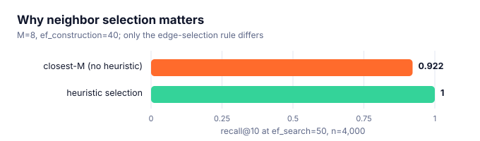
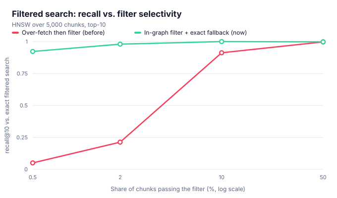

# Benchmarks

Measured with ragforge's own code by
[`scripts/generate_benchmarks.py`](https://github.com/fragompul/ragforge/blob/main/scripts/generate_benchmarks.py) -- no external
benchmarking framework and no hand-typed figures. Regenerate with:

```bash
python scripts/generate_benchmarks.py
```

Machine: `Darwin arm64`, Python `3.12.14`, ragforge `0.2.0`.
Absolute numbers vary by machine; the *shapes* (crossover, recall curve, speedups)
are what matter. Quality on real data with real embeddings lives in
[`evaluation.md`](evaluation.md).

---

## 1. Vector search: exact vs. HNSW

Clustered unit vectors (32-d, 20 Gaussian clusters), 60 queries per
size, top-10. Recall is measured against the exact result set on the same corpus.
HNSW overtakes the exact pure-Python scan from about **1,000 chunks**.

<picture><source media="(prefers-color-scheme: dark)" srcset="assets/ann_latency_dark.svg"></picture>

| Corpus | Exact pure-Python p50 (ms) | Exact NumPy p50 (ms) | HNSW p50 (ms), ef=50 | Recall@10, ef=50 | Recall@10, ef=200 | HNSW build (s) |
| ---: | ---: | ---: | ---: | ---: | ---: | ---: |
| 1,000 | 2.425 | 0.022 | 0.208 | 1.000 | 1.000 | 0.8 |
| 5,000 | 12.491 | 0.057 | 0.241 | 1.000 | 1.000 | 4.8 |
| 20,000 | 51.147 | 0.176 | 0.607 | 0.998 | 0.998 | 26.5 |

HNSW build is the price of sub-linear queries: each insertion runs a graph search.
The pure-Python implementation is built for clarity and zero dependencies; the NumPy
backend shows how far a vectorized exact scan goes before an ANN index is needed.

### `ef_search` is a real recall dial

<picture><source media="(prefers-color-scheme: dark)" srcset="assets/ann_recall_dark.svg"></picture>

At the largest corpus (20,000 chunks):

| `ef_search` | p50 query (ms) | Recall@10 |
| ---: | ---: | ---: |
| 4 | 0.210 | 0.863 |
| 8 | 0.192 | 0.863 |
| 16 | 0.277 | 0.938 |
| 32 | 0.392 | 0.993 |
| 64 | 0.555 | 0.998 |
| 128 | 0.795 | 0.998 |

Widening the beam trades latency for recall along a smooth curve, as the HNSW
paper predicts. (An earlier version of this repository showed recall *plateauing*
near 0.55 regardless of `ef_search`; that was a defect of the implementation, not of
HNSW -- see the next section.)

### Ablation: the neighbor-selection heuristic

The first HNSW implementation linked each new node to its `M` *closest* candidates.
On clustered data that wires a node to a clump of mutually redundant neighbors, the
graph fragments into islands, and recall collapses as the corpus grows. The paper's
heuristic (Algorithm 4) keeps a candidate only if it is closer to the new node than
to every neighbor already chosen, which preserves edges that leave the cluster.

<picture><source media="(prefers-color-scheme: dark)" srcset="assets/ann_ablation_dark.svg"></picture>

| Edge selection | Recall@10 (ef_search=50, n=4,000) |
| :--- | ---: |
| closest-M (no heuristic) | 0.922 |
| heuristic selection | 1.000 |

---

## 2. BM25: inverted index vs. naive scan

`BM25Index` keeps postings (`term -> {chunk: tf}`), so a query only touches chunks
that contain a query term. The previous implementation re-tokenized counts for every
chunk on every query. Zipf-distributed vocabulary, 60-token chunks, 4-term queries:

| Chunks | Naive scan p50 (ms) | Inverted index p50 (ms) | Speedup |
| ---: | ---: | ---: | ---: |
| 1,000 | 2.08 | 0.174 | **12x** |
| 5,000 | 10.91 | 0.735 | **15x** |
| 20,000 | 44.36 | 3.603 | **12x** |

---

## 3. Filtered vector search

Metadata filters (tenant, category, date) are everywhere in production, and graph indexes are
notoriously bad at them: the graph does not know which nodes pass the filter. The earlier
implementation fetched `10 x k` neighbors and filtered afterwards, which **returns too few -- or no --
results when the filter is selective**. Filters now run *inside* the traversal (every node
helps navigation, only passing nodes can be results, the beam widens until it holds `ef_search`
accepted candidates) with a visit cap, and an **exact scan over the passing chunks** completes the
answer when the cap is hit. 5,000 chunks, top-10; recall against exact filtered search:

<picture><source media="(prefers-color-scheme: dark)" srcset="assets/filtered_recall_dark.svg"></picture>

| Filter passes | Over-fetch recall | Returns (of 10) | In-graph recall | Returns (of 10) | p50 ms (before / now) |
| :--- | ---: | ---: | ---: | ---: | ---: |
| 50% (2,500 chunks) | 0.998 | 10.0 | 0.998 | 10.0 | 0.33 / 0.33 |
| 10% (500 chunks) | 0.912 | 9.1 | 1.000 | 10.0 | 0.34 / 1.55 |
| 2% (100 chunks) | 0.212 | 2.1 | 0.980 | 10.0 | 0.33 / 1.82 |
| 0.5% (25 chunks) | 0.050 | 0.5 | 0.922 | 10.0 | 0.32 / 1.89 |

---

## 4. Persistence: JSON vs. memory-mapped directory

`RagPipeline.save` writes one JSON file; `DiskIndex` writes a directory with float32
vectors in a memory-mapped file, the HNSW graph in compact binary adjacency arrays, chunks as
JSON lines, and a manifest as the atomic commit record. Each format is opened in a **fresh Python
process** (so peak RSS is honest), then 150 queries are run. 20,000 chunks, HNSW backend, 128-d vectors.

| | JSON | Directory (mmap) |
| :--- | ---: | ---: |
| Size on disk (MB) | 65.4 | 18.4 |
| Open time (s) | 0.46 | 0.16 |
| Peak memory (MB) | 476 | 142 |
| Vector query p50 (ms) | 1.45 | 2.10 |

The directory format also supports **incremental ingest, deletion and compaction** without rewriting the
index, and survives a crash mid-append (an interrupted tail is ignored and overwritten).
BM25 postings are rebuilt from `chunks.jsonl` at open, which is a linear pass over the text.

---

## 5. Ingestion throughput

Chunking (`RecursiveCharacterChunker`) plus BM25 and vector indexing, single-threaded,
using the default `hashing_embed`.

| Documents | Chunks | Elapsed (s) | Docs / s |
| ---: | ---: | ---: | ---: |
| 1,000 | 1,000 | 0.01 | 73,935 |
| 4,000 | 4,000 | 0.05 | 74,365 |
| 12,000 | 12,000 | 0.16 | 72,875 |

With a real embedding provider the model call dominates; production ingestion is
bounded by the provider's batch limits, not by ragforge's chunking or indexing.
