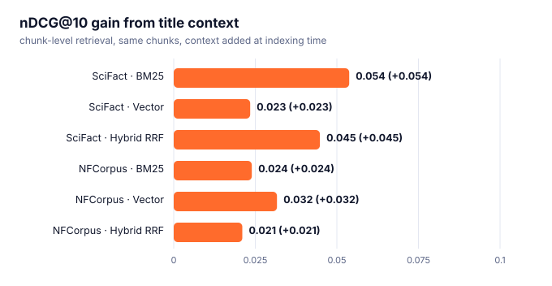

# Contextual retrieval: measured

A chunk like *"The compound reduced tumour growth by 40 %"* cannot be matched to a query about a specific
drug unless the chunk says which drug. **Contextual retrieval** prepends a short situating
context to each chunk **at indexing time** (`RagPipeline(contextualizer=...)`, `Chunk.index_text`);
answers and citations still use the original chunk text. Here the context is the cheapest
deterministic one -- the document **title** (`title_context_fn`) -- and the experiment holds
everything else fixed (same chunks, same ~300-char splitting, same metrics).
Chunk rankings are collapsed to document rankings and scored against BEIR's human judgments.
ragforge 0.2.0.

```bash
python scripts/eval_contextual.py --data-root data --datasets scifact,nfcorpus --embedder minilm
```

<picture><source media="(prefers-color-scheme: dark)" srcset="assets/eval_contextual_dark.svg"></picture>

## SciFact

5,183 documents split into 34,489 chunks; 300 test queries; vectors: MiniLM-L6-v2.

| System | nDCG@10 plain | nDCG@10 + title context | Δ | Recall@100 plain | Recall@100 + context |
| :--- | ---: | ---: | ---: | ---: | ---: |
| BM25 | 0.597 | 0.651 | **+0.054** | 0.897 | 0.917 |
| Vector | 0.673 | 0.696 | **+0.023** | 0.938 | 0.943 |
| Hybrid RRF | 0.673 | 0.718 | **+0.045** | 0.954 | 0.963 |

## NFCorpus

3,633 documents split into 25,738 chunks; 323 test queries; vectors: MiniLM-L6-v2.

| System | nDCG@10 plain | nDCG@10 + title context | Δ | Recall@100 plain | Recall@100 + context |
| :--- | ---: | ---: | ---: | ---: | ---: |
| BM25 | 0.294 | 0.318 | **+0.024** | 0.234 | 0.242 |
| Vector | 0.304 | 0.336 | **+0.032** | 0.304 | 0.314 |
| Hybrid RRF | 0.332 | 0.353 | **+0.021** | 0.304 | 0.315 |

## Reading it

- A positive Δ means the title made chunks easier to find. The effect is largest for **BM25**, which has no
  other way to learn what a chunk is about, and for corpora whose titles are informative.
- The deterministic title context is free. `llm_context_fn` (one model call per chunk, as in Anthropic's
  *contextual retrieval* write-up) produces richer context at a real cost; it is not measured here
  because it needs an LLM key -- the plumbing is identical.
- Context lengthens every indexed chunk, which can dilute BM25's length normalization and the embedding;
  check the **Recall@100** columns and the rows where Δ is small or negative before enabling it everywhere.
