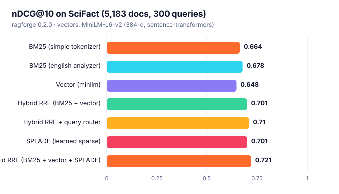
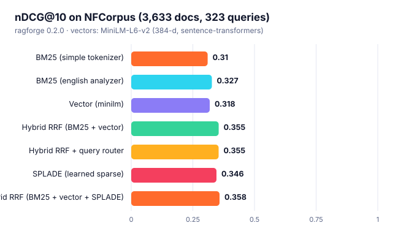
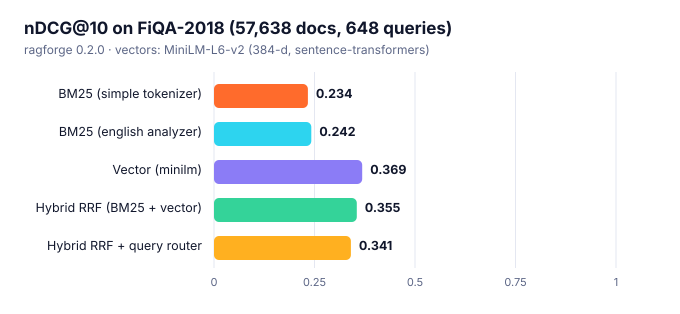
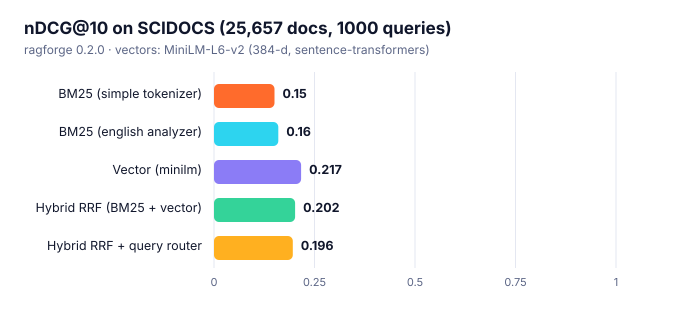

# Retrieval quality on public benchmarks

Hand-picked examples prove nothing, so ragforge's retrievers are scored on the
[BEIR](https://github.com/beir-cellar/beir) benchmark (Thakur et al., 2021): human-judged
queries over real corpora. Everything below is produced by one command:

```bash
python scripts/eval_beir.py --download scifact nfcorpus fiqa scidocs --data-root data
python scripts/eval_beir.py --data-root data --datasets scifact,nfcorpus,fiqa,scidocs \
    --embedder minilm --splade scifact,nfcorpus --quantization scifact,nfcorpus
```

Rankings come from ragforge's own indexes and `FusionRetriever`; scores from
`ragforge.metrics` (nDCG@10 is BEIR's headline metric). ragforge 0.2.0.

## Summary: nDCG@10

| System | SciFact | NFCorpus | FiQA-2018 | SCIDOCS | Mean |
| :--- | ---: | ---: | ---: | ---: | ---: |
| BM25 (simple tokenizer) | 0.664 | 0.310 | 0.234 | 0.150 | **0.340** |
| BM25 (english analyzer) | 0.678 | 0.327 | 0.242 | 0.160 | **0.352** |
| Vector (minilm) | 0.648 | 0.318 | 0.369 | 0.217 | **0.388** |
| Hybrid RRF (BM25 + vector) | 0.701 | 0.355 | 0.355 | 0.202 | **0.403** |
| Hybrid RRF + query router | 0.710 | 0.355 | 0.341 | 0.196 | **0.400** |
| SPLADE (learned sparse) | 0.701 | 0.346 | – | – | **–** |
| Hybrid RRF (BM25 + vector + SPLADE) | 0.721 | 0.358 | – | – | **–** |

*(Mean is shown only for systems evaluated on every dataset.)*

**How to read this.** BM25 and MiniLM land on the published BEIR numbers for these datasets,
which is the sanity check that the implementations are correct rather than merely plausible.

- Equal-weight hybrid fusion beats the best single retriever on SciFact (0.701 vs. 0.678), NFCorpus (0.355 vs. 0.327).
- It does **not** on FiQA-2018 (0.355 vs. 0.369), SCIDOCS (0.202 vs. 0.217): there one retriever is much stronger than the other and unweighted fusion lands between them. Fusion helps when both rankers are competent; weights are the knob when they are not.
- The query router (fixed rules, not tuned on these sets) helps on SciFact (+0.010) and hurts on FiQA-2018 (-0.015), SCIDOCS (-0.006) relative to plain hybrid; elsewhere it is within +-0.005.

## SciFact

5,183 documents, 300 test queries. Vectors: MiniLM-L6-v2 (384-d, sentence-transformers).

<picture><source media="(prefers-color-scheme: dark)" srcset="assets/eval_scifact_dark.svg"></picture>

| System | nDCG@10 | Recall@10 | Recall@100 | MRR@10 | p50 query (ms) |
| :--- | ---: | ---: | ---: | ---: | ---: |
| BM25 (simple tokenizer) | **0.664** | 0.782 | 0.886 | 0.634 | 1.7 |
| BM25 (english analyzer) | **0.678** | 0.803 | 0.907 | 0.646 | 0.5 |
| Vector (minilm) | **0.648** | 0.790 | 0.928 | 0.606 | 0.3 |
| Hybrid RRF (BM25 + vector) | **0.701** | 0.835 | 0.955 | 0.665 | 0.9 |
| Hybrid RRF + query router | **0.710** | 0.841 | 0.948 | 0.677 | 0.9 |
| SPLADE (learned sparse) | **0.701** | 0.812 | 0.938 | 0.673 | 1.2 |
| Hybrid RRF (BM25 + vector + SPLADE) | **0.721** | 0.862 | 0.965 | 0.682 | 2.4 |

### Quantized vectors (SciFact)

Same MiniLM vectors, searched in code space. *Overlap* is the fraction of the exact top-10
that the quantized search also returns; memory counts the searched codes only (rescoring
keeps the float vectors in a separate, disk-friendly store).

| Setting | nDCG@10 | Overlap@10 vs exact | Bytes / vector | p50 (ms, pure Python) |
| :--- | ---: | ---: | ---: | ---: |
| float32 exact (baseline) | 0.648 | 1.000 | 1536 | 0.17 |
| int8 + rescoring | 0.648 | 1.000 | 384 | 23.79 |
| int8 codes only | 0.649 | 0.995 | 384 | 23.63 |
| binary + rescoring (x8) | 0.645 | 0.930 | 48 | 1.15 |
| binary codes only | 0.573 | 0.556 | 48 | 0.86 |

### HNSW on real embeddings (SciFact)

Recall@10 of the from-scratch HNSW index (`M=16`, `ef_construction=100`) against exact search
over the same 5,183 vectors, 150 queries. Build time 46 s (pure Python).

| `ef_search` | Recall@10 | p50 latency (ms) |
| ---: | ---: | ---: |
| 10 | 0.923 | 1.09 |
| 20 | 0.967 | 1.67 |
| 50 | 0.991 | 3.05 |
| 100 | 0.997 | 4.89 |
| 200 | 1.000 | 7.81 |

## NFCorpus

3,633 documents, 323 test queries. Vectors: MiniLM-L6-v2 (384-d, sentence-transformers).

<picture><source media="(prefers-color-scheme: dark)" srcset="assets/eval_nfcorpus_dark.svg"></picture>

| System | nDCG@10 | Recall@10 | Recall@100 | MRR@10 | p50 query (ms) |
| :--- | ---: | ---: | ---: | ---: | ---: |
| BM25 (simple tokenizer) | **0.310** | 0.152 | 0.235 | 0.519 | 0.1 |
| BM25 (english analyzer) | **0.327** | 0.158 | 0.243 | 0.531 | 0.1 |
| Vector (minilm) | **0.318** | 0.159 | 0.315 | 0.508 | 0.1 |
| Hybrid RRF (BM25 + vector) | **0.355** | 0.171 | 0.325 | 0.564 | 0.3 |
| Hybrid RRF + query router | **0.355** | 0.171 | 0.319 | 0.567 | 0.3 |
| SPLADE (learned sparse) | **0.346** | 0.167 | 0.286 | 0.560 | 0.4 |
| Hybrid RRF (BM25 + vector + SPLADE) | **0.358** | 0.171 | 0.322 | 0.571 | 0.8 |

### Quantized vectors (NFCorpus)

Same MiniLM vectors, searched in code space. *Overlap* is the fraction of the exact top-10
that the quantized search also returns; memory counts the searched codes only (rescoring
keeps the float vectors in a separate, disk-friendly store).

| Setting | nDCG@10 | Overlap@10 vs exact | Bytes / vector | p50 (ms, pure Python) |
| :--- | ---: | ---: | ---: | ---: |
| float32 exact (baseline) | 0.318 | 1.000 | 1536 | 0.06 |
| int8 + rescoring | 0.318 | 1.000 | 384 | 16.82 |
| int8 codes only | 0.319 | 0.993 | 384 | 16.58 |
| binary + rescoring (x8) | 0.311 | 0.855 | 48 | 0.94 |
| binary codes only | 0.250 | 0.471 | 48 | 0.61 |

## FiQA-2018

57,638 documents, 648 test queries. Vectors: MiniLM-L6-v2 (384-d, sentence-transformers).

<picture><source media="(prefers-color-scheme: dark)" srcset="assets/eval_fiqa_dark.svg"></picture>

| System | nDCG@10 | Recall@10 | Recall@100 | MRR@10 | p50 query (ms) |
| :--- | ---: | ---: | ---: | ---: | ---: |
| BM25 (simple tokenizer) | **0.234** | 0.300 | 0.507 | 0.289 | 17.2 |
| BM25 (english analyzer) | **0.242** | 0.310 | 0.545 | 0.291 | 2.9 |
| Vector (minilm) | **0.369** | 0.439 | 0.710 | 0.446 | 2.6 |
| Hybrid RRF (BM25 + vector) | **0.355** | 0.436 | 0.700 | 0.425 | 5.6 |
| Hybrid RRF + query router | **0.341** | 0.409 | 0.672 | 0.412 | 5.6 |

## SCIDOCS

25,657 documents, 1000 test queries. Vectors: MiniLM-L6-v2 (384-d, sentence-transformers).

<picture><source media="(prefers-color-scheme: dark)" srcset="assets/eval_scidocs_dark.svg"></picture>

| System | nDCG@10 | Recall@10 | Recall@100 | MRR@10 | p50 query (ms) |
| :--- | ---: | ---: | ---: | ---: | ---: |
| BM25 (simple tokenizer) | **0.150** | 0.156 | 0.349 | 0.269 | 6.4 |
| BM25 (english analyzer) | **0.160** | 0.168 | 0.366 | 0.279 | 2.0 |
| Vector (minilm) | **0.217** | 0.231 | 0.509 | 0.361 | 1.2 |
| Hybrid RRF (BM25 + vector) | **0.202** | 0.212 | 0.483 | 0.345 | 3.1 |
| Hybrid RRF + query router | **0.196** | 0.206 | 0.442 | 0.336 | 3.0 |

## Notes

- **BM25 (simple)** is the library default; the `english` analyzer adds stopword removal and
  light stemming.
- **Vector** is exact cosine search (`NumpyVectorIndex`).
- Quantized-search latencies are **pure Python** (no SIMD), where scanning int8 codes is slower than the
  float scan; the point of quantization here is the 4-32x memory reduction at unchanged quality.
- **Hybrid** fuses the `english` BM25 ranking with the vector ranking (weighted RRF, `k=60`).
- **Query router** (`ragforge.routing.QueryRouter`) changes the fusion weights per query using
  transparent rules (identifiers/quoted phrases/rare terms favor BM25; long natural-language
  questions favor vectors). Its thresholds were fixed *before* running these benchmarks and
  were not tuned on them.
- **SPLADE** (`naver/splade-cocondenser-ensembledistil`) is a learned sparse retriever served
  from an inverted index (`SparseVectorIndex`); weights are the top-96 terms per text.
- With the dependency-free `hashing_embed` the vector side is a weak bag-of-words signal;
  bring a real embedding model.

Dataset licences: BEIR datasets carry their own licences (SciFact CC BY-NC 2.0; NFCorpus,
FiQA, SCIDOCS research use). They are downloaded by the script, not redistributed here.
