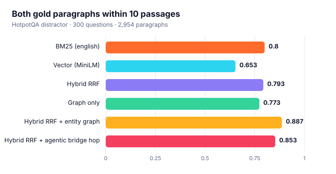

# Multi-hop retrieval and abstention

Single-pass retrieval often finds one of the two paragraphs a multi-hop question needs and
misses the other. This report measures how well ragforge's strategies recover **all** gold
paragraphs on **HotpotQA** (distractor setting, validation split; Yang et al., 2018; CC BY-SA 4.0),
using a shared corpus of 2,954 paragraphs built from 300 questions, so every
distractor is a real Wikipedia paragraph. Vectors: MiniLM-L6-v2 (384-d). ragforge 0.2.0.

```bash
python scripts/eval_multihop.py --download --data-root data     # needs: pip install pyarrow
python scripts/eval_multihop.py --data-root data --embedder minilm
```

## Retrieval: are both supporting paragraphs in the context?

Context budget: **10 passages** for every system (the agent spends 5 per hop).
*Recall* is the mean fraction of gold paragraphs found; *both gold* is the share of questions where
**all** of them are in the context. *Bridge* questions need a hop through an entity named only in the
first paragraph; *comparison* questions name both entities up front.

<picture><source media="(prefers-color-scheme: dark)" srcset="assets/eval_multihop_dark.svg"></picture>

| System | Recall | Both gold | Bridge | Comparison |
| :--- | ---: | ---: | ---: | ---: |
| BM25 (english) | 0.900 | **0.800** | 0.729 | 0.988 |
| Vector (MiniLM) | 0.815 | **0.653** | 0.569 | 0.878 |
| Hybrid RRF | 0.895 | **0.793** | 0.716 | 1.000 |
| Graph only | 0.853 | **0.773** | 0.739 | 0.866 |
| Hybrid RRF + entity graph | 0.940 | **0.887** | 0.844 | 1.000 |
| Hybrid RRF + agentic bridge hop | 0.922 | **0.853** | 0.807 | 0.976 |

**Reading it.** The best system here is *Hybrid RRF + entity graph* (88.7% vs. 79.3%
for plain hybrid). Whatever the ranking, check the bridge and comparison columns separately: bridge questions are
where a second hop *should* matter, comparison questions are mostly solved by the first retrieval.
No rule or threshold was tuned on this data; the bridge rewrite is the deterministic
`ragforge.agent.bridge_rewrite_fn` and the graph is the heuristic `GraphIndex` (no model, no LLM).
An LLM-driven decompose/rewrite loop (`llm_rewrite_fn`) is the natural next step and is not measured here.

## Abstention: does the agent know when it cannot answer?

The agent's default lexical sufficiency grader (share of question terms covered by the retrieved
passages) run on the 300 answerable questions and on 150 **unanswerable** ones --
HotpotQA questions whose gold paragraphs are *not* in the corpus.

| Abstain below | Wrongly refused (answerable) | Correctly refused (unanswerable) |
| ---: | ---: | ---: |
| 0.3 | 0.0% | 4.0% |
| 0.5 | 1.3% | 24.7% |
| 0.7 | 12.7% | 77.3% |

A purely lexical grader is a blunt instrument: unanswerable multi-hop questions still share many common
words with unrelated paragraphs, and answerable ones paraphrase their evidence. Treat this as the
baseline that an LLM- or NLI-based grader (`llm_grade_fn`) should beat, and pick the threshold
for your cost of a wrong refusal vs. a wrong answer.
